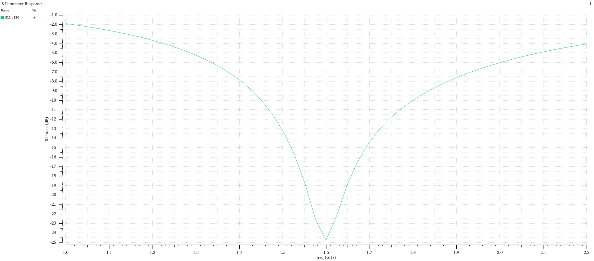
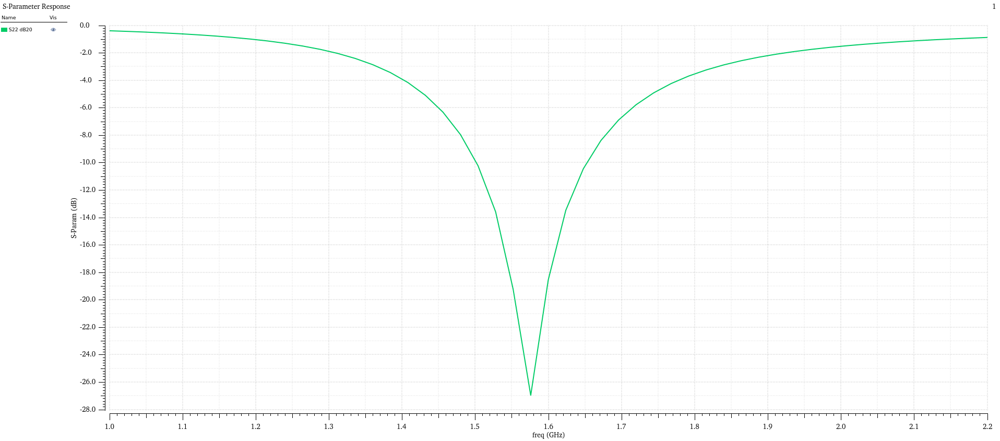
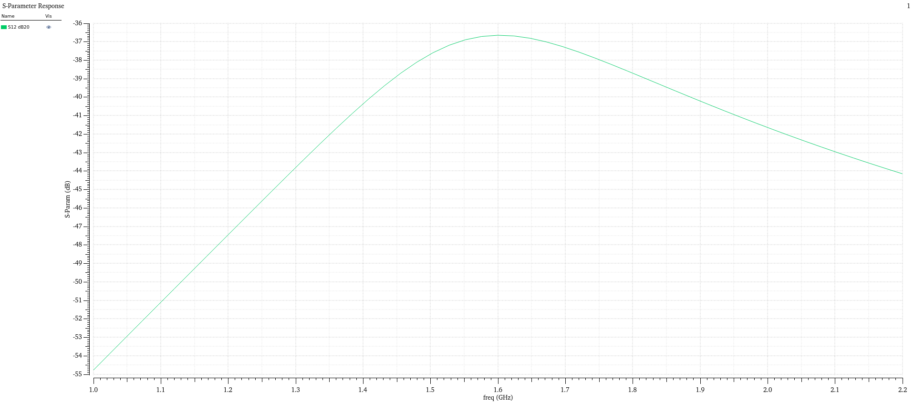
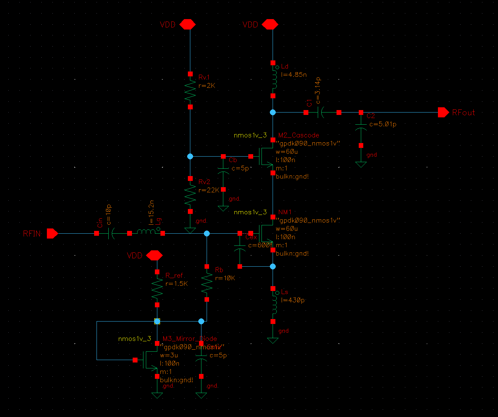
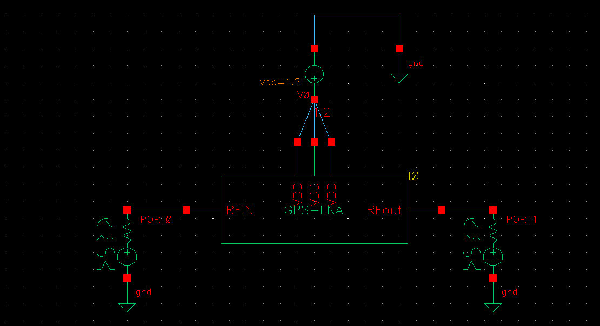
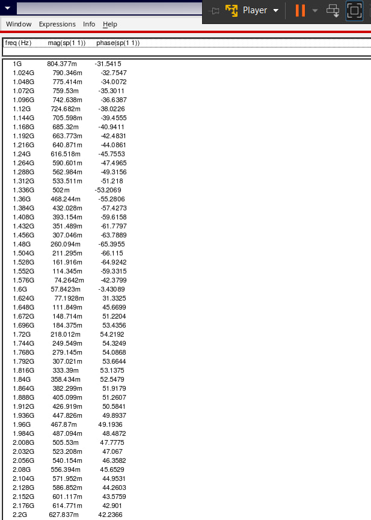
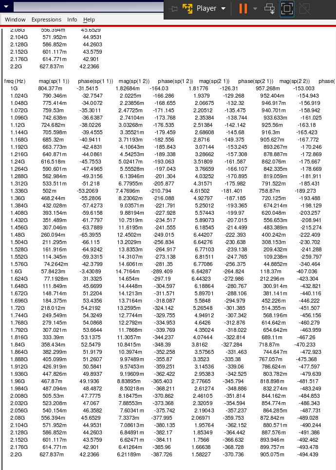

# 1.575 GHz GPS L1 LNA in 90 nm CMOS (Cadence Virtuoso, gpdk090)

An inductively degenerated cascode LNA for the GPS L1 band (1.57542 GHz), designed and simulated in Cadence Virtuoso with the generic `gpdk090` PDK. I started from hand calculations, simulated them in Spectre, and then retuned the design against what the simulator showed. This README records the final values, the iterations that got me there, and the problems I hit on the way.

**Author:** Mayank Singh ([@mayankish](https://github.com/mayankish))

**Status:** DC operating point and S-parameters are done at the typical corner (27 °C, VDD = 1.2 V). Noise figure, linearity, PVT corners and layout are not done yet. They are listed under [What is not done](#what-is-not-done).

---

## Results at a glance

Typical corner, 27 °C, VDD = 1.2 V, 50 Ω ports, ideal inductors with Q = 10 at 1.575 GHz.

| Metric | Result at 1.575 GHz | Comment |
|---|---|---|
| S11 | **-22.6 dB** | Best -24.8 dB at 1.60 GHz. Below -10 dB from about 1.46 to 1.80 GHz |
| S22 | **-27.0 dB** | Below -10 dB from about 1.50 to 1.65 GHz |
| S21 (gain) | **16.6 dB** | Peak 16.7 dB at 1.55 GHz. 3 dB bandwidth about 1.35 to 1.75 GHz (about 400 MHz) |
| S12 (isolation) | **-36.7 dB** | Cascode doing its job |
| Rollett K | about 5 | Computed by hand from my S-parameter table. I still need to plot Spectre's `Kf` to confirm |
| Supply current / power | about 9.7 mA / about 11.6 mW | Worked out from the DC operating point currents |
| Noise figure | not simulated yet | |
| IIP3 / P1dB | not simulated yet | |

The passband is much wider than GPS needs (a few MHz). That is expected with on-chip inductors at Q around 10, and the gain is flat across the L1 band. A SAW filter does the channel selection in a real receiver.

---

## Plots

All plots come from one `sp` sweep (1 to 2.2 GHz).

### S11


### S22


### S12



---

## Circuit

### Schematic


### Testbench
`GPS_LNA_tb` has the LNA symbol, a 1.2 V `vdc` on VDD, and two 50 Ω `port` sources (port 1 on RFIN, port 2 on RFout).



### How the circuit works

```
                     VDD
                      |
          Rv1 2k     Ld 4.95n
            |         |------C1------ RFout
            +-- Vb    |        C2 (to gnd)
            |     --- M2 (cascode)
          Rv2 22k     |
            |        M1 (60u/100n)
           gnd        |
                     Ls 0.88n
                      |
                     gnd

RFin -- Cin -- Lg --+-- gate of M1   (Cex across gate and source)
```

- **Input match.** `Lg`, `Cex`, the gate capacitance of M1 and `Ls` form a series resonance at 1.575 GHz. The real part of the input impedance does not come from a resistor. It comes from `Ls` feeding back the drain current, and it is about `gm * Ls / Ctot`. That gives me a 50 Ω match without a noisy physical resistor. `Cex` is an extra capacitor across gate and source. It lets me pick a reasonable `Lg` (about 14 nH instead of about 100 nH) and makes the match less dependent on the exact gate capacitance.
- **Cascode (M2).** It isolates the output from the input, which is where the -37 dB reverse isolation comes from, and it keeps the gain stage stable.
- **Output network.** `Ld` and the capacitance at the drain form a parallel tank. `C1` and `C2` do two jobs: they are part of the tank capacitance, and they act as an L-match that transforms the 50 Ω load up to the tank resistance seen at the drain.
- **Bias.** `M3` is a diode-connected copy of M1 at 1/20 the width. `R_ref` sets its current (about 0.45 mA), and it is mirrored 20 times into M1. `Rb` (10 kΩ) feeds the gate bias in without loading the RF input. `Rv1`/`Rv2` set the cascode gate voltage at 1.1 V.

---

## Final component values

### Transistors (cell `nmos1v_3`, model `gpdk090_nmos1v`, bulk to `gnd!`)

| Instance | Length | Total width | Role |
|---|---|---|---|
| NM1 | 100 nm | 60 µm | Input common-source device |
| M2_Cascode | 100 nm | 60 µm | Cascode device |
| M3_Mirror_Diode | 100 nm | 3 µm | Bias mirror reference (1:20 ratio with NM1) |

No PMOS devices are used. The 60 µm devices are built from several fingers because the cell limits the width of a single finger (see [problems](#problems-i-ran-into)).

### Inductors (analogLib `ind`, Q = 10 at 1.575 GHz)

| Name | Value | Where |
|---|---|---|
| Lg | 13.8 nH | RFin side, in series with the gate |
| Ls | 0.88 nH | Source degeneration to ground |
| Ld | 4.95 nH | VDD to the M2 drain (output tank) |

### Capacitors

| Name | Value | Where |
|---|---|---|
| Cin | 10 pF | RFin DC block |
| Cex | 600 fF | Gate to source of NM1 |
| C1 | 3.21 pF | Drain to RFout (series) |
| C2 | 4.77 pF | RFout to ground (shunt) |
| Cb | 5 pF | M2 gate bypass |
| Cmir | 5 pF | Bias node bypass |

### Resistors

| Name | Value | Where |
|---|---|---|
| Rv1 | 2 kΩ | VDD to Vb |
| Rv2 | 22 kΩ | Vb to ground |
| Rb | 10 kΩ | Gate bias feed from the mirror node |
| R_ref | 1.5 kΩ | VDD to M3 drain (sets Iref) |

---

## DC operating point

From `dcOp` at 27 °C. All three devices are in saturation (`region = 2`).

| Quantity | NM1 | M2_Cascode | M3_Mirror_Diode |
|---|---|---|---|
| Id | 9.18 mA | 9.18 mA | 448 µA |
| gm | 48.5 mS | 50.4 mS | 2.40 mS |
| Vgs | 528 mV | 544 mV | 528 mV |
| Vds | 556 mV | 644 mV | 528 mV |
| Vth | 220 mV | 247 mV | 223 mV |
| Vdsat | 215 mV | 217 mV | 214 mV |

NM1 carries about 10 % more current than my target of 8.3 mA. The mirror ratio works out to about 20.5 instead of 20 because NM1's Vds (556 mV) is higher than M3's (528 mV), so channel-length modulation adds a bit of current. I left it because it did not hurt the RF results.

<!-- add: images/CIW_dcOp_NM1_M2.png and images/CIW_dcOp_M3.png (Results > Print > DC Operating Points) -->



---

## How I designed it

### Targets
- Centre frequency 1.57542 GHz (GPS L1), 50 Ω in and out.
- S11 and S22 better than -10 dB, gain in the range of 15 to 20 dB, good reverse isolation.
- VDD = 1.2 V, power around 10 mW.

### First-pass hand calculations
These are the assumptions I started with. Some were off, and that mattered (see the iteration section).

| Assumption | Value |
|---|---|
| gm of NM1 | 55 mS |
| Cgs of NM1 | 100 fF |
| Inductor Q | 10 |
| Cascode output resistance | about 1.4 kΩ |
| Drain parasitic capacitance | 100 fF |

1. **Input resonance.** With `Ctot = Cgs + Cex = 0.7 pF` and the 10 pF series `Cin`, resonance at 1.575 GHz needs `Lg + Ls = (1/w0^2)(1/Ctot + 1/Cin)`, which came to 15.6 nH.
2. **Input resistance.** I wanted `gm * Ls / Ctot + R(Lg) + Rg = 50 ohm`. With about 15 Ω lost in `Lg` (Q = 10) this gave `Ls = 0.43 nH`, so `Lg = 15.2 nH`.
3. **Output tank.** I picked `Ld = 4.85 nH` and sized `C1`/`C2` as an L-match from 50 Ω up to about 357 Ω (the tank resistance with Q = 10 in parallel with the cascode output resistance). That gave `C1 = 3.14 pF`, `C2 = 5.01 pF`.
4. **Bias.** M3 at 1/20 the width of M1, `R_ref = 1.5 kΩ` for a 0.41 mA reference, and a 2 kΩ / 22 kΩ divider for a 1.1 V cascode gate.

---

## Iterations

### Iteration 1: the hand-calculated values

| Lg | Ls | Ld | C1 | C2 | Inductor Q |
|---|---|---|---|---|---|
| 15.2 nH | 0.43 nH | 4.85 nH | 3.14 pF | 5.01 pF | not set (ideal) |

Result at 1.576 GHz: S11 = -6.1 dB, S21 = 23.8 dB, S22 = -6.2 dB. Rollett K was about 0.9 (not unconditionally stable).

What the S-parameters told me:

- The S11 phase crossed 180° at **1.528 GHz** with a real input impedance of only about **17 Ω**. So the input resonance was about 3 % low and the resistance far below 50 Ω.
- The S22 minimum was near 1.59 GHz and the output looked like about **145 Ω**. That is what you get from a lossless tank: with no loss in `Ld`, the tank resistance is just the cascode output resistance (about 1 kΩ), not the 357 Ω my match assumed.
- The 23.8 dB gain was too good to be true for the same reason. I had not put any Q on the inductors, so there was no loss anywhere.

<!-- add: images/CIW_sp_table_iter1.png (the iteration 1 S-parameter table) -->


### Iteration 2: recalibrated from the simulation

I used the first run to correct my assumptions instead of guessing:

| Quantity | What I assumed | What the simulation showed |
|---|---|---|
| gm of NM1 | 55 mS | 48.5 mS |
| Gate capacitance (including Miller and parasitics) | 0.7 pF with Cex | about 0.75 pF effective |
| Real input resistance per nH of Ls | about 29 Ω/nH (from `gm/Ctot`) | about 40 Ω/nH (measured) |
| Cascode output resistance | 1.4 kΩ | about 1.0 kΩ |
| Drain parasitic capacitance | 100 fF | about 65 fF |

Then I redid the numbers with the inductor Q included (Q = 10 at 1.575 GHz on Lg, Ls and Ld):

- Required `Lg + Ls = 14.7 nH` to resonate at 1.575 GHz with the effective gate capacitance.
- `Ls` raised until `40 ohm/nH * Ls + 14.5 ohm (inductor loss) = 50 ohm`, which gave `Ls = 0.88 nH` and `Lg = 13.8 nH`.
- Tank resistance about 330 Ω with `Ld` Q = 10 and the 1 kΩ cascode resistance. `C1`/`C2` re-solved for that, and `Ld` set so the tank resonates at 1.575 GHz.

| Lg | Ls | Ld | C1 | C2 | Inductor Q |
|---|---|---|---|---|---|
| 13.8 nH | 0.88 nH | 4.95 nH | 3.21 pF | 4.77 pF | 10 at 1.575 GHz |

Cin, Cex, the resistors and the bias stayed the same.

Result at 1.575 GHz: S11 = -22.6 dB, S21 = 16.6 dB, S22 = -27.0 dB, S12 = -36.7 dB. K comes out around 5 from the S-parameters.

<!-- add: images/CIW_sp_table_final.png (the final S-parameter table) -->


### Side by side

| | Iteration 1 | Iteration 2 |
|---|---|---|
| S11 at 1.575 GHz | -6.1 dB | -22.6 dB |
| S22 at 1.575 GHz | -6.2 dB | -27.0 dB |
| S21 at 1.575 GHz | 23.8 dB | 16.6 dB |
| Rollett K | about 0.9 | about 5 |

The gain went down and I think that is the honest number. The first run had lossless inductors, which made the gain look better than a real inductor would allow.

---

## Problems I ran into

**1. VDD was wired backwards.** My first DC run showed NM1 and M2 in `region = 3` (subthreshold) with a drain current of about 0.6 µA instead of 8 mA. The `vgb = -1.1 V` was the giveaway: the bias divider was producing 1.1 V from a **negative** rail. The `vdc` source was connected with its plus and minus swapped. Swapping the wires fixed it, and the next DC run gave the currents above.

**2. The PDK limits the width of one finger.** I entered a total width of 60 µm for NM1 and M2 and the CIW printed:

> `*Warning* Total Width (w) parameter: 60u exceeds the upper limit of 30u! Parameter value is set to its upper limit!`

That silently clamped the device to 30 µm, which would have halved the gm. Changing the **Multiplier** did nothing to the Total Width field. What worked was building the width from fingers, for example 10 fingers at 6 µm or 20 fingers at 3 µm, and keeping the multiplier at 1. The 30 µm limit is per finger. I also kept NM1 and M3 on the same unit finger width so the 1:20 mirror ratio stays a clean count of fingers.

<!-- add: images/CIW_width_warning.png (the CIW warning and the CDF form) -->


**3. Hand calculation versus Spectre.** My first assumptions were off in several places (see the table in iteration 2). The one that cost me the most was forgetting that a lossless `Ld` makes the output tank resistance several times higher than my match assumed, so S22 was nowhere near 50 Ω. Reading the S11 and S22 phases directly (where they cross the real axis) told me exactly how far off each resonance and resistance was.

**4. Ideal inductors flatter the circuit.** With no Q on the inductors, I got 23.8 dB of gain and a deceptively easy-to-hit resonance. Adding Q = 10 brought the gain down and made the match more realistic. Anything I quote should come from the version with loss.

**5. Mirror ratio drift.** The 1:20 mirror gave about 9.2 mA instead of 8.3 mA because of the Vds mismatch between M3 and NM1. I left it alone and changed only the RF components, so I could tell which change caused which effect.

**6. Setting up the testbench.** A few small things cost time: creating a symbol before the testbench, naming the cell with an underscore (`GPS_LNA_tb`), and remembering that the Results menu stays greyed out until a simulation has actually run.

<!-- add: images/CIW_reversed_vdd_dcop.png (the region = 3 operating point from problem 1), if you kept the screenshot -->


---

## How to reproduce

1. Library: `LNA`, schematic `GPS-LNA`, symbol made from the schematic. Testbench `GPS_LNA_tb`.
2. Testbench: `vdc` = 1.2 V on VDD (plus terminal on VDD, minus to `gnd`), `port` 1 on RFIN (50 Ω), `port` 2 on RFout (50 Ω).
3. ADE: simulator `spectre`, model library `gpdk090` (typical section), temperature 27 °C.
4. Analyses: `dc` with *Save DC Operating Point*, and `sp` from 1 GHz to 2.2 GHz with ports 1 and 2.
5. Inductors: Q = 10 at 1.575 GHz on Lg, Ls and Ld.
6. Plots: Results > Direct Plot > Main Form, analysis `sp`, function `SP`, modifier `dB20`.

---

## What is not done

- **Noise figure.** I have not run it yet. I expect it to be dominated by the loss in `Lg`, but I do not want to write down a number before I have simulated it.
- **Linearity.** IIP3 and P1dB need a `pss` setup (swept power and two-tone).
- **Stability.** K was computed by hand from the S-parameter table. I still want the Spectre `Kf` and `mu` plots over the whole band.
- **PVT corners.** Everything above is typical, 27 °C, VDD = 1.2 V.
- **Inductor models.** Lg, Ls and Ld are ideal analogLib inductors with a Q setting, not spiral inductors with real parasitics.
- **PDK.** `gpdk090` is a generic PDK without RF-qualified models, so absolute numbers (especially noise) should not be read as silicon predictions.
- **Layout and extraction.** None yet. Gate resistance and parasitics from layout will shift the input match, since `Ls` is only 0.88 nH.

---

## Repository layout

```
.
├── README.md
└── images/
    ├── LNA_DESIGN_SCHEMATICS.png
    ├── LNA_SYMBOL_SCHEMATICS.png
    ├── S11.jpg
    ├── S12.jpg
    ├── S22.jpg
    ├── S21.png                  (to add)
    ├── Kf_mu.png                (to add)
    ├── NF.png                   (to add)
    ├── CIW_dcOp_NM1_M2.png      (to add)
    ├── CIW_dcOp_M3.png          (to add)
    ├── CIW_sp_table_iter1.png   (to add)
    ├── CIW_sp_table_final.png   (to add)
    ├── CIW_width_warning.png    (to add)
    └── CIW_reversed_vdd_dcop.png (optional)
```
